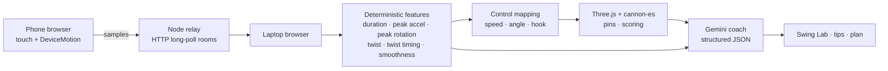

<div align="center">

# MotionPlay AI

**Your phone becomes the controller. Swing it to bowl on your laptop, then get coached by Gemini<br>on what your motion actually did.**


[What it does](#what-it-does) · [How a throw works](#how-a-throw-works) · [Architecture](#architecture) · [Gemini](#where-gemini-is-used-and-where-it-is-not) · [Play](#play) · [Run it](#run-it) · [Deploy](#deploy) · [Limits](#limits)

</div>

## What it does

A hackathon project for the Google DeepMind challenge, built around one idea: **turn a device people
already own into a motion controller, and make the feedback about the motion measurable instead of
vague.**

| | |
|---|---|
| **Phone as controller** | Scan a QR code, tap *Enable motion*, hold the screen, swing, release to bowl. No app install, no extra hardware. |
| **Real physics** | A 3D lane, ball and ten pins in Three.js with cannon-es rigid bodies, and standard ten-frame scoring. |
| **Swing Lab** | Your measured angular velocity over normalised time, laid over your best throw, with stat tiles and a phone replay. |
| **Gemini coaching** | After each throw: one insight, one tip and a consistency score over your last 20 throws, as schema-validated JSON. |
| **Adaptive controls** | Ask for gentler or smaller movements and Gemini rewrites the control mapping; a practice plan updates after games. |
| **Voice coach** *(optional)* | A Gemini Live session you talk to while bowling; it can change the game through function calls. |
| **Camera replay** *(optional)* | MediaPipe Pose on the laptop camera adds visual evidence to the coaching. |

<p align="center"><sub>The look is inspired by approachable console-sports menus. It does not use Nintendo hardware or any Wii SDK.</sub></p>

## How a throw works



1. Hold the phone screen to record. Recording only while held makes swing detection trivial.
2. Release to let go of the ball. The phone sends one validated batch of **3 to 360** samples
   (`t`, acceleration, rotation rate on three axes); the laptop rejects anything non-finite,
   out of order or implausibly large.
3. The laptop computes swing features **locally and deterministically**: duration, peak
   acceleration, peak rotation speed, wrist twist and when in the swing it happened, smoothness.
4. Features map to ball speed, direction and hook. **Physics decides the pins**, not the model.
5. Features, result and the last 20 throws go to the coach; the reply is validated against a
   schema before anything is shown.

## Architecture

| Part | Where | What it does |
|---|---|---|
| Pairing and transport | `server/relay.js`, `src/net.js`, `src/controller/` | In-memory rooms over HTTP long-polling, so phone and laptop need not share a network. QR pairing, sensor permission, haptics on release |
| Motion | `src/motion/` | Sample validation, feature extraction, and the adjustable mapping to throw parameters |
| Game | `src/game/` | Three.js lane, cannon-es physics (12 solver iterations, sleeping bodies), ten-frame scoring, audio |
| Swing Lab and replay | `src/ui/swinglab.js`, `src/ui/twin.js` | Measured profile over the best throw; a small 3D figure that repeats the swing from gyro rates alone |
| Coach | `api/coach.js`, `src/coach/` | Gemini via `@google/genai`, JSON schema output, labeled local fallback if unavailable |
| Adapt and plan | `api/adapt.js`, `api/plan.js`, `src/ui/` | Control adaptation and practice plans, each with tests |
| Voice | `api/live-token.js`, `src/coach/live.js` | Gemini Live session with function calls into the game |
| Camera | `src/camera/` | MediaPipe Pose landmarks (33 per sample), joint angles scaled by frame aspect, replay |
| Shared contract | `src/shared/contract.js` | `Sample`, `Features`, `ThrowParams`, `ThrowResult`, `CoachReply`, written first so parallel work fit together |

## Where Gemini is used, and where it is not

Gemini **explains and adapts**; it never decides what the pins do.

- **Not in the loop:** feature extraction, control mapping, physics, scoring. All deterministic and
  unit-tested.
- **In the loop:** coaching text, control adaptation, practice plans, voice, and multimodal feedback
  when the camera is on. Every structured reply is parsed and validated, and the request body is
  size-capped on the server.
- **Key handling:** `GEMINI_API_KEY` lives only in `.env.local` and the server environment, never in
  a `VITE_` variable or client source.

## Play

Open https://aaravdagoat.tail732914.ts.net:10000 on your laptop (served from a home server through
Tailscale Funnel; the Vercel site cannot run the pairing relay). Scan the QR code with your phone, tap
**Enable motion**, allow the sensor prompt, hold the screen, swing, release. A game has ten frames;
use **New game** or swing again after completion to restart.

Hardware volume buttons are not reliably exposed by mobile browsers, so hold-to-record on the
touchscreen is the supported control.

## Run it

Node 22.12+ or 24.

```text
npm install
echo GEMINI_API_KEY=your-key > .env.local   # git-ignored
npm run dev
npm test        # 67 tests across 13 files
npm run build
node scripts/verify-coach.mjs   # one real Gemini check with synthetic measurements
```

Phone motion needs **HTTPS**; plain HTTP over your Wi-Fi IP will not enable the sensors. Use the
deployed URL for real phone testing. The last twenty throws are kept in the laptop browser's local
storage.

## Deploy

**Your own server (the full game).** The relay keeps open connections in memory, so the game needs
one long-running Node process:

```text
npm install && npm run build
GEMINI_API_KEY=your-key PORT=8080 npm start
```

`npm start` serves the built site, `/api/coach` and `/relay` from one port. Put HTTPS in front (Caddy,
nginx or a tunnel).

**Vercel (coaching only).** The `motionplay-ai` project serves the static site and `/api/coach` as a
function (https://motionplay-ai.vercel.app). Set `GEMINI_API_KEY` as a sensitive production variable
and `vercel deploy --prod`.

## Limits

Stated plainly, because the demo is easy to over-read:

- A phone gives true **rotation**, not true **arm position**. The replay draws a rigid arm at an
  assumed length and is labeled a motion profile, not a 3D reconstruction.
- It is **not** multiplayer, a native app, calibrated motion capture, a trained model, a medical
  product, or a proven bowling trainer. Accessibility and skill-improvement benefits are design goals,
  not validated claims.
- Automated tests and the production build pass. **Real-phone sensor testing, live microphone and
  webcam checks, and paid Gemini calls** were not re-verified in the latest review; earlier operational
  notes in `SWARM.md` are historical.
- Swing Lab shows measured angular velocities, not a reconstructed arm path. Coaching falls back to a
  labeled local response when Gemini is unavailable.

More detail for reviewers: [`TECHNICAL_CONTEXT_AND_JUDGE_QA.md`](TECHNICAL_CONTEXT_AND_JUDGE_QA.md)
(architecture, motion maths, tradeoffs, trust boundaries, judge Q&A) and [`PLAN.md`](PLAN.md).
