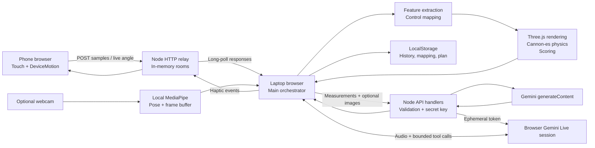

# MotionPlay AI — technical context and hackathon judge preparation

Reviewed against the local source on **15 November 2026**. This document describes the implemented application, not every feature proposed in historical planning documents.

**Verification in this review:** `npm.cmd test` passed **67 tests across 13 files**. `npm.cmd run build` passed, with a large-bundle warning. No physical-phone sensor, live microphone, webcam, production deployment, or paid Gemini call was newly verified for this document. Earlier operational observations in `SWARM.md` are historical reports, not fresh checks.

## Contents

1. [Pitch and scope](#1-pitch-and-scope)
2. [Architecture and code map](#2-architecture-and-code-map)
3. [A throw from beginning to end](#3-a-throw-from-beginning-to-end)
4. [Sensors and motion mathematics](#4-sensors-and-motion-mathematics)
5. [Physics, scoring, and feedback](#5-physics-scoring-and-feedback)
6. [Networking and pairing](#6-networking-and-pairing)
7. [Gemini integrations](#7-gemini-integrations)
8. [Camera and replay](#8-camera-and-replay)
9. [Persistence and statistics](#9-persistence-and-statistics)
10. [Decisions and tradeoffs](#10-decisions-and-tradeoffs)
11. [Security, privacy, and trust boundaries](#11-security-privacy-and-trust-boundaries)
12. [Deployment and verification](#12-deployment-and-verification)
13. [Known gaps and claims to avoid](#13-known-gaps-and-claims-to-avoid)
14. [Judge questions and follow-ups](#14-judge-questions-and-follow-ups)
15. [Demo runbook and roadmap](#15-demo-runbook-and-roadmap)

## 1. Pitch and scope

### Twenty-second explanation

MotionPlay AI turns a phone into a motion controller for a bowling game on a laptop. The phone measures a held movement; local code maps it to a physical ball simulation. Gemini explains the result, can adapt the controls to comfortable movements, and provides voice coaching and practice plans. An optional laptop camera adds visual evidence.

### The problem and intended benefit

The prototype explores lowering the barrier to motion-controlled play using devices people already have, offering control sensitivity that can fit smaller movements, and making practice more understandable through measured feedback. These are design goals, not validated claims of improved skill, clinical benefit, or universal accessibility.

### What is implemented

- One laptop and one phone per lane; browser-based pairing by QR code.
- Hold-to-record motion input and live pre-release ball animation.
- A 3D bowling lane, rigid-body pin collisions, and ten-frame scoring.
- Deterministic motion features and adjustable control mappings.
- Swing Lab profiles, a best-throw comparison, and phone rotation replay.
- Structured Gemini coaching after throws, with labeled local fallback.
- Requested control adaptation and a visual practice target.
- Optional Gemini Live voice interaction with game functions.
- Optional MediaPipe pose tracking, camera replay, and multimodal coaching.
- Local history and a training plan that can be updated after games.

### What the project is not

It is not multiplayer competition, a native phone app, a calibrated motion-capture system, a trained custom AI model, a medical product, or a proven real-world bowling trainer. The UI is inspired by approachable console sports menus; it does not depend on Nintendo hardware or a Wii SDK.

## 2. Architecture and code map



The browser owns the game simulation. The server routes messages, serves built assets, validates AI requests, and protects the long-lived Gemini key. The phone relay and Gemini Live connection are separate transports.

| Area | Main files | Responsibility |
|---|---|---|
| Laptop shell | `index.html`, `src/main.js` | UI layout, tabs, orchestration, races, state transitions |
| Phone shell | `controller.html`, `src/controller/main.js` | Permissions, hold gesture, recording, status, wake lock |
| Capture validation | `src/controller/capture.js` | Sensor extraction and sample bounds |
| Transport | `src/net.js`, `server/relay.js` | Host/join abstraction and long-poll relay |
| Motion | `src/motion/features.js`, `mapping.js` | Signal summaries, normalized profiles, ball parameters |
| Game | `src/game/index.js`, `physics.js`, `scoring.js`, `audio.js` | Scene, rigid bodies, scoring, sound |
| Coach client | `src/coach/index.js` | API calls, local history, statistics, fallback |
| AI server helpers | `src/coach/server.js`, `schema.js` | Request bounds, schemas, model calls, reply checks |
| API routes | `api/coach.js`, `adapt.js`, `plan.js`, `live-token.js` | Four distinct AI capabilities |
| Voice | `src/coach/live.js` | Microphone streaming, output audio, tool dispatch |
| Camera | `src/camera/index.js`, `pose.js`, `replay.js` | Camera lifecycle, pose math, frame buffering, replay |
| Panels | `src/ui/swinglab.js`, `twin.js`, `adapt.js`, `plan.js` | Presentation and feature-specific UI |
| Contracts | `src/shared/contract.js` | JSDoc shapes and shared constants; some comments are stale |
| Hosting | `server.js`, `vite.config.js`, `Dockerfile`, `compose.yaml` | Production server, development routes, container setup |
| Test inputs | `fixtures/gen.mjs`, `fixtures/swings.json` | Synthetic motion examples |
| Demo artifacts | `scripts/*demo*`, `*v2*`, `demo-video/` | Recording, narration, editing; not application runtime |

Dependencies declared by the app include Three.js, cannon-es, qrcode, MediaPipe Tasks Vision, and Google's GenAI SDK. Vite builds the two HTML entrypoints, and Vitest runs the tests. The application is plain JavaScript with ES modules, not the TypeScript rewrite proposed in `MOTIONLAB_BUILD.md`.

## 3. A throw from beginning to end

1. **Laptop initializes.** `main.js` creates the game, panels, optional camera/voice interfaces, and restores valid stored control settings.
2. **A room is created.** `host()` generates random room/client identifiers and registers with the relay. The QR encodes a controller URL on the same origin with `?room=...`.
3. **The phone joins.** The relay announces the peer. The laptop sends its current ready/busy state; the phone also sends `hello` to request state synchronization.
4. **The player enables sensors.** A user gesture requests motion permission where required. The app checks secure context and sensor support.
5. **Holding begins a capture.** The pointer that starts the gesture owns its release. Samples are accepted only while recording and within the size/time limits.
6. **Pre-release feedback runs.** The phone integrates a swing angle and sends throttled live updates. The laptop moves the visible ball to follow the gesture. This is presentation, not the physical launch.
7. **Release submits a complete recording.** The phone validates it, sends a `swing` message, and becomes busy. The laptop validates again.
8. **Local features and launch parameters are computed.** No model request is needed to launch the ball.
9. **The game simulates the roll.** `throwBall()` returns a promise. Physics updates the ball and pins; scoring resolves the result after the throw interval.
10. **Feedback is recorded and presented.** The phone replay and Swing Lab show the samples. Real throws enter history; simulated throws do not. Collision feedback can go back to the phone.
11. **Coaching starts asynchronously.** The request includes features, result, trends, mapping, recent throws, and optional camera evidence. The phone is released for another throw without waiting for this model response.
12. **Only the appropriate result reaches the UI.** Throw generation counters prevent an old coaching response from replacing a newer throw or a reset game.

### Important state boundaries

- `game.busy` rejects overlapping throws and changes during a roll.
- The relay host separately tracks whether an incoming swing is being processed.
- `throwNo` invalidates stale coaching updates.
- `adaptRun` invalidates adaptation responses after reset/newer requests.
- Voice tool responses are sent only to the session that requested them.
- Camera start/stop has a run counter so a delayed startup cannot revive a stopped camera.
- Any game containing simulated throws is excluded from completed-game training statistics.

These guards are valuable because network/model responses can finish out of order. They do not establish a general transaction system or full exactly-once message delivery.

## 4. Sensors and motion mathematics

### Capture format

```js
{ t, ax, ay, az, rx, ry, rz }
```

`t` is elapsed milliseconds. Acceleration is in m/s². Rotation rates are in degrees/second, mapped from browser `beta → rx`, `gamma → ry`, and `alpha → rz`.

The implementation requires usable `event.acceleration` and `event.rotationRate`. It deliberately does not substitute acceleration including gravity: a stationary phone would otherwise look as if it were accelerating at roughly gravity. Missing/null values are rejected instead of becoming fake zero measurements.

Validation requires 3–360 samples, strictly increasing nonnegative timestamps, timestamps no later than 6,000 ms, at least 30 ms between first and last sample, finite sensor fields, and absolute field values at most 10,000. These broad raw bounds are defensive limits, not a sensor calibration specification. API feature bounds are tighter, so a raw-valid extreme input can still be rejected by coaching validation.

Capture is canceled after six seconds, on focus loss, page hiding, canceled pointers, or lost pointer capture. Permission success alone does not prove usable sensor data; a five-second warning handles missing readings. Browser sampling frequency is device-dependent.

### Feature definitions

| Feature | Actual calculation | Interpretation/limit |
|---|---|---|
| `durationMs` | Last sample time minus first sample time | Recorded interval; not exactly touch-down to release |
| `peakAccel` | Maximum `hypot(ax, ay, az)` | Peak acceleration magnitude |
| `peakRot` | Maximum `hypot(rx, rz)` | Swing rotation across two possible grips |
| `twistDeg` | Trapezoidal integral of `ry` | Signed integrated twist under an assumed phone-axis interpretation |
| `twistTiming` | First normalized time at half cumulative absolute twist | Early/late twist heuristic; 0.5 if total twist is negligible |
| `smoothness` | Acceleration total-variation heuristic | Signal regularity, not biomechanical quality |

For acceleration magnitudes `a[i]`, let `V = Σ|a[i] − a[i−1]|` and `P = max(a)`. The code computes:

```text
excess = max(0, V − 2P)
smoothness = 1 / (1 + excess / max(2P, 1))
```

When peak acceleration is below 0.05, smoothness is 1. A still signal can therefore look maximally smooth; this must never be presented as perfect athletic technique.

The profile is linearly resampled in time to **50 points**, preserving amplitude. Swing is the magnitude of interpolated `rx/rz`; twist is interpolated `ry`. The horizontal axis is normalized swing time, not distance traveled. Comparing equal-length profiles makes different-duration throws easier to visualize, but hides absolute duration unless the separate metric is considered.

### Mapping to gameplay

```text
Default: gain = 1, twistGain = 1, mode = swing

swing energy = 0.65 × peakAccel / 55 + 0.35 × peakRot / 800
gentle energy = max(peakAccel / 20, peakRot / 250, abs(twistDeg) / 55)

speed = clamp(energy × gain, 0, 1)
angle = clamp(twistDeg / 180 × twistGain, −0.65, 0.65)
spin  = clamp(twistDeg / 100 × twistGain, −1, 1)
```

Allowed gain is 0.5–6; twist gain is 0–2. Gentle mode allows one type of small movement to supply the input rather than requiring strong acceleration and rotation together. Setting twist gain to zero removes twist-based steering/hook.

**Worked example:** peak acceleration 20, peak rotation 300, twist 18°, default mapping gives energy ≈0.3676, speed ≈0.3676, angle 0.10, and spin 0.18. The physics launch then uses forward speed ≈10.94 world units/s and lateral speed 0.22 world units/s.

These constants are authored game tuning. They are not learned weights or experimentally established bowling mechanics. Saturation means higher sensor values may stop producing a faster ball.

## 5. Physics, scoring, and feedback

Sources: `src/game/physics.js`, `scoring.js`, `index.js`.

### Rendering versus simulation

Three.js renders the lane, ball, pins, lights, and target. cannon-es owns rigid-body positions, orientations, and collisions. Each render copies physics transforms into meshes. Visual live aiming affects the ball mesh before launch; it does not rewrite the underlying physics world.

### Physical model

- Gravity: `(0, −9.82, 0)`; solver iterations: 12; sleeping enabled.
- Ball: sphere radius 0.32, mass 5.
- Pins: mass 1.3, compound cylinder and sphere collision shapes.
- Ten pins are arranged in four triangular rows.
- Lane/ball friction 0.025 and restitution 0.12.
- Lane/pin friction 0.32 and restitution 0.12.
- Pin/pin friction 0.2 and restitution 0.35.
- Pin/ball friction 0.18 and restitution 0.35.

Launch velocity is `(angle × 2.2, 0, −(8 + speed × 8))`; angular velocity is `(-(8 + speed × 8)/0.32, spin × 8, 0)`. Even normalized speed zero produces a playable roll at 8 world units/s.

Hook is an authored lateral force of `spin × 1.8`, applied on physics substeps while the ball is in the lane region. It is not a detailed oil-pattern/friction model. The fixed simulation step is **1/120 second**, with up to eight catch-up substeps per call. The render loop slices elapsed time into intervals up to 1/30 second and caps a frame's elapsed time at 0.25 seconds. This improves refresh-rate consistency, but long background pauses do not simulate unlimited missed wall time.

A throw resolves after approximately **5.5 simulated seconds**, rather than waiting for a formally detected stable state. A pin counts as down if its up-axis y component is below 0.78, its position is too low, or it is displaced more than 0.48 horizontally from its spot. Downed pins are disabled and moved away; standing pins are re-spotted to eliminate residual movement.

### Scoring

`BowlingScore` is independent of rendering. It handles strikes, spares, open frames, unresolved bonuses, and tenth-frame bonus rolls. An unresolved frame total remains null until future rolls establish the bonus. Tests cover a 300 perfect game, 150 all-spare game, gutter/open games, impossible pin counts, and tenth-frame rack rules.

### Drills and feedback

A drill places a target corridor and measures whether the ball crosses it near z = −8.5. Its width is bounded to 0.65–1 and target side to −1…1. **It changes the visual goal, not the physical lane width or pin collision rules.**

Pin collision strength triggers sound and phone feedback. Main limits the collision vibration notification to one per throw, preventing a burst for every contact. Strike/spare patterns provide additional feedback. Vibration and the iOS switch-tick workaround are best effort; browser and OS support vary. Synthesized crash audio is unlocked by a user gesture.

## 6. Networking and pairing

Sources: `src/net.js`, `server/relay.js`.

### Protocol

```text
GET  /relay/:room/:side?client=:clientId   wait for queued messages
POST /relay/:room/:side?client=:clientId   send to the opposite side
side = host | phone
```

Room/client IDs generated by the browser use 12 cryptographically random bytes, hex encoded: 96 bits each. One registered client is allowed on each side. A different client attempting that side receives 409. POSTs must match the registered client ID or receive 403. This is possession-based pairing, not user-account authentication.

A poll waits up to **20 seconds**, then returns an empty array. A missing side is cleaned up after **six seconds without re-establishing a poll**. Initial polls return promptly. Queued messages are returned as a JSON array. POST payloads are capped at **128 KiB**; overflow is dropped from the buffer and rejected. When the opposite peer is absent, sending returns 404.

Messages include `swing`, `live`, `hello`, `status`, `peer`, and `haptic`. The relay mostly forwards data; receiving application code performs message-specific validation.

### Responsiveness and reconnects

Long-polling does not mean waiting 20 seconds for a throw: an outstanding poll is answered as soon as a message arrives. Twenty seconds is the idle timeout. The phone emits live angle updates at intervals of at least 60 ms and drops intermediate updates while a prior request is in flight. Full swing recordings are sent once on release.

Clients retry a failed poll after 1.5 seconds. The phone keeps its client ID across reconnects and uses `hello` to recover the host's ready/busy state. A controller restored from the browser back-forward cache reloads instead of keeping a closed connection. The laptop clears stale live aiming after 1.2 seconds.

### Why this transport exists

The recorded development sequence in `SWARM.md` is PeerJS/WebRTC → SSE → HTTP long-polling. The notes report failed WebRTC connectivity on the user's network, followed by SSE buffering through a tunnel. Long-polling was chosen to work with that deployment path using ordinary requests. This is evidence about the tested setup, not proof that WebRTC or SSE never work through tunnels.

Tradeoffs: more HTTP overhead than a persistent socket; an in-memory single process; no durable replay or acknowledgment protocol; no exact-once delivery guarantee; no distributed room storage. A server restart drops rooms. Scaling would require shared ownership/message routing, quotas, and stronger recovery semantics—not simply adding container replicas.

## 7. Gemini integrations

### A. Post-throw coaching: `/api/coach`

Input includes features, result, numeric trends, optional mapping/question/recent history, optional pose/path comparison, and up to six JPEG strings. Request data is whitelisted into known fields. Feature/result bounds and body size are checked before model invocation.

The response schema is `insight`, `tip`, and `consistency`. The server adds provenance (`source`, `model`, `vision`). `vision: true` means image parts were supplied to a successful generation; it is not a guarantee that the person was visible or that every observation is correct.

The prompt asks for one grounded observation and one comfortable next action. It distinguishes sensor, synthetic, tap, and unknown sources; asks the model not to invent visual observations; warns against causal/medical interpretations; and treats incoming text/images as data. These are mitigations, not a mathematical guarantee against hallucination or prompt injection.

### B. Control adaptation: `/api/adapt`

The UI uses recent real throw history (last five through the current main wiring), optional player language, pinfall, and trends. At least one real recorded throw is required by the UI flow. The API accepts 1–10 feature records. Gemini returns a bounded mapping, a drill, rationale, and 1–4 evidence statements.

The prompt includes the actual mapping equations so recommendations have a concrete relationship to the game. It targets normalized ball speed around 0.6–0.8 for the supplied comfortable movement. The validator rejects arbitrary code or out-of-range gains.

**Current interaction:** clicking “Adapt controls to me” requests and applies the result after validation. It does not have a separate preview/apply step, although old build plans and some prompt/fallback wording describe one. Reset restores default mapping, clears the drill, and invalidates pending adaptation responses.

### C. Training plans: `/api/plan`

The main UI requires at least three stored real throws. The API itself accepts 1–20 throws, up to ten finished-game scores, trends, and a previous-plan string up to 1,200 characters. A plan contains `focus`, 1–4 `steps`, and `progress`.

The UI saves the plan and finished games locally and requests a rewrite after a completed real-only game. This is contextual generation using recent measurements, not model fine-tuning. There is no cloud player account or cross-device learning database.

### Shared generation pipeline

`src/coach/server.js` calls the REST `generateContent` endpoint using a server-side `GEMINI_API_KEY`. The configured primary model is `GEMINI_MODEL` or the code's default `gemini-flash-latest`; a second attempt uses `gemini-flash-lite-latest`. These are configured identifiers, not a claim about current provider availability.

Each attempt has a 12-second timeout. Generation requests use temperature 0.35, maximum output tokens 1,800, JSON MIME type, and a response JSON schema. Returned text is parsed and checked again. The client timeout is 26 seconds, allowing roughly two server attempts. A response schema reduces malformed output but does not establish factual accuracy.

Both server and coach/adaptation client have local fallbacks. The UI labels fallback output. `getPlan()` reports transport failure rather than silently creating a browser fallback; the plan server handler itself does return a labeled local plan if generation fails.

### D. Live voice: `/api/live-token` and `src/coach/live.js`

The server mints an ephemeral token through `@google/genai`, configured for one use, a one-minute new-session window, and expiry 30 minutes ahead. It constrains the model to the code's `gemini-3.8-live` identifier. The system prompt and tools are configured by browser code rather than fully locked into token constraints.

The browser obtains microphone permission, requests mono audio with echo cancellation/noise suppression, converts samples to signed 16-bit PCM at a requested 16 kHz, and streams them to Gemini Live. Returned audio is played as 24 kHz mono PCM. Input/output transcriptions are shown. Interrupted output stops queued audio. Stopping the session closes audio contexts and microphone tracks.

Live tools:

| Function | Effect |
|---|---|
| `set_controls` | Validate and persist a bounded mapping |
| `set_drill` | Validate and display a target corridor |
| `clear_drill` | Remove the target |
| `new_game` | Reset score when not busy |
| `get_stats` | Return controls, score, recent statistics, and current plan |
| `review_last_throw` | Await the latest post-throw review, including camera-derived coaching when available |

The Live coach is instructed to call functions before claiming it changed anything and to inspect stats/review data before answering those questions. Function names are allowlisted through the actions object and handlers validate settings. Errors go back to the model. Voice does not directly receive the webcam stream; it can retrieve the separate multimodal review.

Audio uses deprecated `ScriptProcessorNode` for implementation simplicity. Moving capture to `AudioWorklet`, explicitly validating actual sample rates, stronger session constraints, and real-device latency evaluation are sensible improvements.

## 8. Camera and replay

### Local vision pipeline

The optional camera uses MediaPipe Pose Landmarker, loaded on demand. WASM comes from a versioned CDN path matching the package version; the model asset comes from Google storage. It attempts GPU delegation, then CPU. Initial loading therefore requires network access even though inference runs locally.

Camera startup tries a user-facing 640×480 preference, then other cameras if needed, deprioritizing infrared devices. Permission denial is handled separately. The preview is mirrored; images retained for coaching are unmirrored.

The rolling buffer keeps six seconds. JPEG sampling is limited to one every 100 ms; pose buffer insertion to every 30 ms. These are target intervals, not guaranteed device throughput. Each stored JPEG is capped at 36,000 base64 characters by lowering quality. A capture selects up to six evenly spaced frames plus the full local clip.

### Measurements and their limits

- Both shoulders must be visible with confidence above 0.5.
- The likely throwing side is the hand that traveled farther, with ties favoring the right.
- Pose summaries include arm sweep, release wrist height relative to shoulders, shoulder tilt, and average visibility.
- Distances are normalized by shoulder width; image aspect ratio is accounted for.
- Hips/legs are not required by the current measurement logic. Do not claim knee/foot coaching from it, despite stale test names and older notes.
- A low-confidence/out-of-view wrist can be estimated by extending the shoulder-to-elbow line. That assumes a straight forearm direction; it is an estimate, not observed hand position.
- Hand paths are smoothed with neighboring points and reduced to roughly forty samples.

Replay compares a normalized hand path with the best previous throw's path, or with a constant-radius pendulum derived from the current path when no reference exists. Comparison uses 21 normalized positions and returns mean/worst gap, worst timing, and release offsets. It is not dynamic time warping, metric 3D reconstruction, or a professional form benchmark.

### Timing alignment

On swing receipt, main captures a recent camera window covering motion duration plus 300 ms. A second capture runs 500 ms later using duration plus 800 ms to include follow-through. The phone and laptop do not have an explicit synchronized timestamp protocol; alignment is approximate and can shift with relay latency. The earlier stills/pose and later replay/path window are related but not identical.

### Phone replay is a different technique

`src/ui/twin.js` integrates three-axis gyro rates into quaternions. It estimates a dominant rotation axis using a covariance-like matrix and 16 power iterations, assumes the first clear excursion is the backswing, and maps relative rotation into a stand-in figure's coordinate frame. Spherical interpolation animates between samples; a fixed arm length creates the visible trail.

The phone measures rotation, not absolute arm position. The avatar is explanatory. Grip assumptions, integration drift, and axis interpretation limit accuracy. Sensor samples can be downloaded as JSON. Do not describe this as a true biomechanical digital twin.

## 9. Persistence and statistics

| Storage key | Contents |
|---|---|
| `motionplay.throws.v1` | Last 20 valid real throw records |
| `motionplay.mapping.v1` | Current control mapping |
| `motionplay.plan.v1` | Training plan and up to ten completed-game scores |

History falls back to memory when storage is unavailable and returns cloned data so callers do not mutate stored records accidentally. Records include features, profile, launch parameters, result, timestamp, and sometimes normalized hand path. Raw webcam image clips are held in memory, not written to history by this implementation.

The best throw is highest pinfall, with smoothness as a tiebreaker. This is useful for personal comparison but does not account for which pins were standing or whether the attempt was a spare conversion.

Consistency is computed from the coefficients of variation of duration and peak acceleration:

```text
CV(x) = population standard deviation(x) / abs(mean(x))
consistency = round(max(0, 1 − (CV(duration) + CV(peakAccel))/2) × 100)
```

Fewer than two throws gives zero. Other trends are mean pinfall, normalized speed, duration, and Pearson speed–pinfall correlation, clamped to [−1,1], with zero for an undefined denominator. This describes a small recent sample, not causation or a clinically meaningful score. Gemini's reply also has a consistency field; that model-produced value should not be confused with an independent validation of the deterministic statistic.

## 10. Decisions and tradeoffs

“Documented” below means supported by development notes or source comments. “Inferred” means an engineering rationale consistent with the code, not a verified recollection of the developer's intent.

| Decision | Rationale and benefit | Tradeoff / alternative | Evidence |
|---|---|---|---|
| Browser phone controller | Avoid install and dedicated controller | Browser permissions and sensor inconsistencies; native app offers more control | Documented product direction |
| Hold then release | Explicit recording boundary; avoids automatic swing detection | Requires touch coordination; accidental cancellation possible | Documented in plan |
| Plain JS + Vite | Small direct modules and quick prototype integration | Less compile-time safety; TS could strengthen contracts | Stack documented; motivation inferred |
| Three.js + cannon-es | Separate rendering from reusable rigid-body simulation | Extra bundle weight; simplified physics requires tuning | Documented stack |
| Local feature/mapping computation | Immediate gameplay and testable equations | Authored thresholds are device/grip sensitive | Implemented; motivation inferred |
| AI outside launch loop | Model latency cannot block bowling | Advice arrives after the outcome | Implemented and regression-tested |
| Fixed physics substeps | Hook behavior less dependent on display refresh | CPU cost; no promise of cross-platform bitwise identity | Source comment and test |
| HTTP long-polling | Address actual WebRTC/tunnel issues | HTTP overhead and in-memory state | Historical handoffs |
| One Node process | Keeps relay/API/static hosting simple | No automatic horizontal scaling or durable sessions | Source comment |
| Bounded JSON AI outputs | Maps language into a small executable configuration space | Limits creative actions; still needs factual evaluation | Schemas and prompts |
| Ephemeral Live credentials | Browser can connect without receiving long-lived key | Token minting/session configuration still need hardening | Source comments |
| On-device pose + selected stills | Local feedback plus bounded multimodal request size | Approximate synchronization and occasional visibility failure | Implemented |
| LocalStorage history | No account/database needed | Per-browser retention, easy tampering, no sync | Implemented; rationale inferred |
| Labeled deterministic fallback | Demo/game survives AI outage | No equivalent natural-language interpretation or genuine visual reasoning | Implemented |
| Pale blue/white console UI | Matches requested Wii Sports-inspired direction | Older component styles remain beneath shell overrides | User request and current styles |

### Historical decisions that changed

`PLAN.md` initially specifies PeerJS, Vercel hosting, and no voice/camera/adaptation. Those are historical. The current app uses a long-running Node relay and includes those optional AI features. `MOTIONLAB_BUILD.md` proposes TypeScript/calibration/preview flows that did not fully land. Older warm paper/red/mustard component styles remain, while the current shell overrides much of their presentation with Geist, white, gray, and pale blue.

## 11. Security, privacy, and trust boundaries

### Implemented protections

- Gemini's long-lived key is read only by server helpers/token creation; browser Live gets a short-lived token.
- AI request bodies are capped at 256 KiB, including streaming bodies without content length.
- Known fields, numeric ranges, text sizes, output schemas, and runtime validators constrain requests/actions.
- UI-generated coaching text uses text content rather than executing model HTML.
- Relay POSTs require the registered client ID; one phone per lane is enforced.
- Production API calls are limited to 120 per minute per connecting socket address.
- Camera and microphone are explicit opt-in features with stop controls.
- Coaching prompts limit source interpretation and discourage sensitive/unsupported inferences.

### Data flow to explain accurately

Phone motion travels through the relay to the laptop. Summarized measurements/results go to the AI server and Gemini. With camera enabled, selected JPEGs also leave the device; “all camera data stays local” would be false. Live voice streams microphone audio to Gemini while enabled. Raw frame replay remains local in memory. Browser history persists until cleared or evicted.

This repository does not establish Google's retention/training policies, a legal compliance certification, or deletion of data held by third parties. Check provider/account terms separately before making those promises.

### Security limitations

There are no player accounts, authorization roles, signed competitive scores, or server-authoritative physics. Anyone with sufficient browser access can modify local state. A room link is effectively a pairing capability. Client IDs are not account credentials.

The relay lacks global room/queue quotas and comprehensive per-message schemas. An exposed service could suffer resource exhaustion. AI rate limits key off socket address, so a reverse proxy can make all visitors share one limit. This avoids trusting arbitrary forwarded headers but is not a scalable abuse solution. Vite development routing does not inherit the production server's limiter.

Live token creation lacks user-level quotas and fully locked prompt/tool constraints. Browser tools are intentionally a small allowlist, but there is no production-grade permission/confirmation ledger. Model instructions reduce misuse; they are not an authorization boundary on their own.

## 12. Deployment and verification

### Local development

```powershell
npm.cmd install
npm.cmd run dev
npm.cmd test
npm.cmd run build
```

The Gemini key belongs in ignored `.env.local` for local development. Vite loads it server-side; do not create a public `VITE_` key variable. `npm start` uses Node's environment-file support in the declared script. Node 24 is the Docker image; README also documents compatible modern Node versions.

### Production

Build creates `dist/`. `server.js` serves static assets, the relay, and the four API endpoints on port 8080 by default. HTML has `no-store`; other served assets receive long immutable caching. The Dockerfile installs dependencies, copies source, builds, and runs `node server.js`.

Compose loads `.env`, binds the application to the configured Tailscale interface on port 8099, and defines a Cloudflare quick tunnel. README/handoff notes describe a fixed Tailscale Funnel HTTPS address with the quick tunnel as a spare. **Current production availability and external auto-deploy configuration were not verified in this review.** Historical notes mention auto-deploy on pushes; the repository alone does not prove that mechanism is active.

Ordinary HTTP over a Wi-Fi address is insufficient for real mobile motion permissions; use HTTPS for the phone. Localhost has special secure-context treatment for desktop development. The Vercel static/AI deployment cannot replace this process-local relay as currently implemented.

### Test evidence

This review ran 67 passing tests in 13 files. Coverage includes motion validation/features, gentler mappings, static/rolling physics, hook consistency across 60/120 Hz, bowling scoring, basic relay exchange, history/trends, AI request and output validation, fallback behavior, image request construction, pose/path math, gyro replay, haptic bounds, and integration race handling.

Build output included approximately 726 kB minified for the main index chunk (194 kB gzip), 392 kB for a web chunk (73 kB gzip), and 154 kB for the vision chunk (45 kB gzip). These are this build's sizes, not total transfer/load-time measurements. Vite warned about a chunk over 500 kB.

Tests use fixtures and mocked provider responses where appropriate. Passing them does not prove real phone permissions, sensor axes, live voice quality, camera robustness, provider availability, production latency, or usability. No coverage percentage, load benchmark, user study, cost benchmark, or quality score was produced.

## 13. Known gaps and claims to avoid

1. **Historical docs conflict with code.** Use source and this dated review for current architecture.
2. **Mapping provenance is incomplete.** `main.js` stores real records without their mapping and supplies recent records without mapping to coaching. The prompt asks for same-control comparisons, but the data does not fully support that filtering. Changes in gain can confound speed trends.
3. **Adaptation preview is not implemented.** Current request applies the validated result. Do not present old “preview/apply” plans as shipped.
4. **No trained player model.** Personalization is recent-history context plus bounded configuration, not gradient updates or fine-tuning.
5. **Phone position is not measured.** Avatar hand paths assume a fixed arm and frame alignment.
6. **Camera measurements are estimates.** Monocular perspective, occlusion, inferred wrists, and heuristic side selection affect them. Pose summary paths can still use uncertain wrist values even though hand-path drawing has a separate fallback.
7. **Synchronization is approximate.** The camera window compensates with fixed offsets; no cross-device clock synchronization is implemented.
8. **Camera API accepts six stills; some prompts/comments still say three.** This is documentation drift worth fixing.
9. **Best throw/trends ignore rack context.** Raw pinfall on a spare attempt is not directly comparable with a fresh rack. Mixed control histories compound the issue.
10. **Physical simulation is stylized.** Hook is an extra force, the roll finishes on a timer, and remaining pins are re-spotted. No calibrated lane oil or professional biomechanics.
11. **Server is prototype-scale.** In-memory rooms, no durable delivery, no user auth, and limited abuse controls.
12. **Plan client validation is weaker.** `getPlan()` returns parsed JSON without a client-side schema check; the server validates generation, but the client trust boundary is less consistent than coach/adapt.
13. **Fallback UI wording needs cleanup.** The adaptation fallback says to preview before applying although main applies it immediately. It correctly admits the language request was not interpreted by Gemini.
14. **Some contracts/test names are stale.** `contract.js` describes `peakRot` as x-only and smoothness too strongly; actual code uses x/z magnitude and a heuristic. Camera tests contain older knee-related naming while current summaries omit knees.
15. **Demo media is supporting material.** Recorded simulations and UI screenshots do not establish real hardware verification. The final compatible MP4 uses H.264 Main/yuv420p; earlier video versions used an incompatible 4:4:4 export. These scripts do not affect game physics.

## 14. Judge questions and follow-ups

Use the short answers aloud. Use the follow-ups when asked to go deeper. Do not claim benchmarks or user results that have not been collected.

### Q1. What did you build?

**Answer:** A browser bowling game controlled by your phone's motion, with Gemini coaching, adaptable sensitivity, replay, and optional camera and voice interaction.

**Follow-up: What is the core innovation?** The prototype connects movement, a playable result, and an explanation in one loop. The same measurements that control the game inform feedback and bounded control adaptation.

**Follow-up: What is original versus reused?** Three.js supplies rendering, cannon-es supplies physics, MediaPipe supplies pose estimation, and Gemini supplies generation/live interaction. The integration, motion features/mapping, game orchestration, relay, coaching context, replay logic, and UI are application code. Do not claim to have created those underlying engines or models.

### Q2. Why does this need AI?

**Answer:** The bowling itself does not need AI. Gemini adds interpretation of measurements and optional images, understands a player's requested movement preference, and turns conversation into validated game actions.

**Follow-up: Could rules do it?** Rules handle the stable tasks already: physics, scoring, features, and basic fallback tips. They could cover more cases, but language requests, multimodal observations, and contextual explanations benefit from a general model. The prototype still needs evaluation showing that model feedback is better than a strong rule baseline.

**Follow-up: Is it just a chatbot wrapper?** The model receives structured game evidence and can call bounded control/drill functions. It is integrated with state and measurements rather than receiving only free-form chat. The quality and usefulness of that integration should be demonstrated, not assumed.

### Q3. How does the phone become a controller?

**Answer:** The player scans a QR code, allows motion access, holds the screen to capture accelerometer and gyro samples, and releases their touch to send the recording. Local math converts it to speed, direction, and spin.

**Follow-up: Do they throw the phone?** No. They keep a firm grip and release only their touch on the screen. Comfortable small movements are encouraged.

**Follow-up: Why not the volume buttons?** Mobile browsers do not reliably expose them. The code has best-effort key handling, but the supported gesture is holding the touchscreen.

### Q4. Are you measuring the phone's exact position?

**Answer:** No. We measure acceleration and angular velocity. The replay integrates rotation and uses a fixed-arm figure to explain it.

**Follow-up: Why not integrate acceleration twice?** Bias, noise, gravity separation, and unknown initial state make position drift rapidly without additional reference information. This prototype intentionally avoids claiming absolute position from phone IMU alone.

**Follow-up: What does the camera add?** A separate visual estimate of upper-body and hand movement. It complements the phone but does not turn the prototype into calibrated 3D motion capture.

### Q5. What is Gemini actually sent?

**Answer:** Motion summaries, the result, recent statistics, and control settings. With camera enabled, selected still frames and pose/path summaries are added. Voice mode streams microphone audio in its own Live session.

**Follow-up: Is every video frame uploaded?** No continuous webcam stream is sent by this coaching path. A capture chooses up to six stills. Local replay can retain more buffered frames in browser memory.

**Follow-up: Does voice see my camera?** Not directly. Its review function retrieves the result of the separate post-throw multimodal analysis.

### Q6. How do you prevent hallucinated coaching?

**Answer:** We provide explicit measurements and provenance, constrain output shape, ask for evidence-grounded observations, and label fallback and simulated inputs. We also tell the model to state when visual evidence is insufficient.

**Follow-up: Does JSON schema guarantee truth?** No. It guarantees structure only to the extent the provider/runtime validation enforces it. Factual grounding needs evaluation against recordings and human judgments.

**Follow-up: Can it diagnose a user's body?** That is not the product's purpose. Prompts prohibit medical or sensitive personal inferences. The measurements and smoothness score are game heuristics, not clinical assessments.

### Q7. What does “learning your style” mean?

**Answer:** We retain up to twenty recent real throws and pass their statistics into coaching/adaptation. A plan can also use previous plans and completed-game scores. We are not retraining Gemini.

**Follow-up: Is personalization persistent?** It persists in that browser's local storage. There is no account-based cross-device profile.

**Follow-up: What would make it more rigorous?** Store control mappings and rack state per throw, segment comparable attempts, establish a baseline, and evaluate improvement over repeated sessions.

### Q8. How do adaptive controls work?

**Answer:** Gemini selects only a mode, power gain, twist gain, and a bounded drill. Local validators and equations determine the actual behavior. Gentle mode lets a smaller acceleration, rotation, or twist supply sufficient input.

**Follow-up: Can it generate arbitrary game code?** No. The returned configuration is data within fixed ranges; it is not evaluated as executable code.

**Follow-up: Does it change automatically without asking?** The panel changes controls when the player requests adaptation. Voice tools can change them in response to requests. The UI does not currently have a separate preview confirmation screen.

**Follow-up: What if the request finishes during a roll?** The mapping setter rejects changes while the game is busy. The user can retry when the roll finishes.

### Q9. Is this accessible?

**Answer:** It is designed to support more comfortable movement ranges through adjustable gain and gentle mode. That is an accessibility-oriented design choice, not proof it works for every person or condition.

**Follow-up: Have you tested with people with limited mobility?** This review has no evidence of such a study. The next step is co-design and testing with intended users, including touch, grip, fatigue, and camera-position constraints.

**Follow-up: Could assistance unfairly improve scores?** Yes; gains affect the game. The prototype is single-player practice. Competitive modes would need explicit assisted categories and controlled settings.

### Q10. How real is the physics?

**Answer:** Pins and the ball use rigid-body collisions. Ball hook is an authored lateral force, and the dimensions/materials are tuned for a game. It is a playable simulation, not a certified bowling model.

**Follow-up: Does the same throw behave the same at different frame rates?** Fixed substeps and a regression test reduce refresh-rate differences; hook is applied per physics step. We do not claim bit-for-bit reproducibility across all hardware.

**Follow-up: Why does a throw finish after 5.5 seconds?** It bounds the interaction and simplifies the demo. A production version could resolve based on ball exit and pin-settling criteria with a maximum timeout.

### Q11. Why long-polling instead of WebSockets or WebRTC?

**Answer:** The development notes record WebRTC connectivity problems and SSE buffering in the chosen tunnel. Long-polling provided a simple ordinary-HTTP path that worked for the prototype deployment.

**Follow-up: Is it slow?** Active polls respond immediately when messages arrive. The twenty-second interval is an idle timeout. Actual end-to-end latency still needs measurement.

**Follow-up: Would you keep it at scale?** We would measure overhead and network behavior, then consider persistent sockets or another transport with shared routing and reconnect semantics. Transport changes alone do not solve room ownership or reliability.

### Q12. Can multiple people play?

**Answer:** The server can hold multiple room entries, but each lane has one laptop and one phone, and the game is single-player. There is no implemented competitive multiplayer mode.

**Follow-up: How many rooms can it handle?** We have not load-tested it. We should report measured concurrency and memory/latency limits rather than invent a capacity number.

**Follow-up: What happens on server restart?** In-memory rooms are lost and clients must re-establish their connections. There is no durable session recovery layer.

### Q13. What happens if Gemini is unavailable?

**Answer:** Bowling continues. Coach/adaptation endpoints can return labeled local output, and the client also handles failure. Training-plan generation has a server fallback. Voice reports unavailability rather than pretending to be a live model.

**Follow-up: Is the fallback equivalent?** No. It uses simple numerical rules and cannot interpret a player's free-form request or camera scene like the model can.

**Follow-up: Can users tell?** Source labels distinguish local fallback from Gemini. Synthetic throws are also identified and excluded from real-player history.

### Q14. How fast is the AI feedback?

**Answer:** We have not measured a representative latency distribution. Each generation attempt has a twelve-second timeout, with up to two model choices, and the client timeout is twenty-six seconds. The next throw is not blocked by coaching.

**Follow-up: How would you measure it?** Instrument release-to-host, host-to-launch, roll completion, request start, first response, and complete response; report medians and p95 by network/device and text versus image use.

### Q15. What does it cost?

**Answer:** No reliable per-session cost measurement exists in this review. Costs depend on text/image request volume, model selection, and Live audio duration. We bound payloads and outputs and avoid an AI call per sensor sample.

**Follow-up: How would you estimate unit economics?** Log provider usage metadata, number of throws, image counts, retries, and voice duration, then apply current provider pricing. Report text-only and camera/voice scenarios separately.

**Follow-up: What are cost controls today?** Request/output caps, timeouts, optional camera/voice, and a production API request limiter. That limiter is not a per-user spend budget.

### Q16. Is my API key exposed?

**Answer:** The long-lived key is read on the server. The browser gets a limited-lifetime Live token, not that key.

**Follow-up: Is the public API fully secure?** No production claim: token minting and public endpoints need stronger user-level quotas, authentication where appropriate, and tighter session constraints. Keys should be rotated if exposed.

### Q17. Does all data stay on-device?

**Answer:** No. Pose inference runs on the laptop, but selected camera images and motion summaries can go to Gemini; voice audio streams while enabled. Local history and replay are browser-side.

**Follow-up: Can you promise third-party deletion or no training?** Not from this code. Those depend on the provider/account configuration and terms, which must be checked separately.

### Q18. Can someone cheat or take over a game?

**Answer:** The relay restricts each side to a registered client ID, but the laptop owns gameplay and scores. It is not an anti-cheat architecture. Anyone modifying their own browser can alter results.

**Follow-up: What would competition require?** Server-authoritative state or verifiable input processing, account/session authentication, anti-replay sequence numbers, abuse controls, and fair control configurations.

### Q19. What is the biggest technical weakness?

**Answer:** Measurement comparability and real-device validation. Grip and sensor behavior vary, camera alignment is approximate, and history currently lacks complete control provenance. Those limit the confidence of coaching claims.

**Follow-up: What would you fix first?** Record mapping/source/rack context on every throw, implement explicit calibration and timing alignment, then run a controlled device/user evaluation.

### Q20. How did you test it?

**Answer:** The reviewed version passes sixty-seven tests across motion, physics/scoring, relay behavior, AI validation/fallback, pose/replay math, and important asynchronous integration cases. The production build also passes.

**Follow-up: Did those tests use live Gemini?** Provider behavior is mocked in unit tests. There is a separate live-check script and historical reports, but this review did not make a fresh live call.

**Follow-up: Is a simulated throw a real demo?** It demonstrates the local mapping/physics/UI path with synthetic measurements. It does not prove phone permission handling or real motion quality; we label that distinction.

### Q21. Why not React, a database, or a native app?

**Answer:** The prototype has a small number of panels and a canvas-heavy game, so direct modules and DOM updates work. Local storage keeps setup small; the browser makes QR onboarding simple. That is a scope tradeoff, not an argument against those technologies.

**Follow-up: What would trigger a rewrite?** Complex shared UI state, account-based progress, offline/native sensor needs, or multiplayer. First improve contracts and modularity rather than rewrite solely for framework preference.

### Q22. Is the camera actually measuring your legs and professional form?

**Answer:** Current summaries focus on shoulders and the throwing arm. They do not require or measure legs/feet. The camera estimates image-space movement; it does not produce a professional biomechanical assessment.

**Follow-up: What if the hand is off-screen?** Hand-path logic may infer a continuation from shoulder and elbow, or omit the point. That can be useful visually but must be treated as an estimate.

### Q23. How do you know the player improved?

**Answer:** We can report recent scores and repeatability metrics, but we have not established causal improvement. Control changes, rack state, and small samples can explain changes in results.

**Follow-up: What experiment would convince you?** Compare fixed-controls/no-coach, fixed-controls/coach, and adaptive-controls/coach conditions; record baselines and mapping changes; measure retention, completion, comfort, and comparable-shot outcomes with sufficient participants.

### Q24. What is the business or broader use case?

**Answer:** The prototype tests a reusable interaction pattern: inexpensive motion input plus understandable feedback and personalized controls. Potential directions include casual browser sports and adaptable interactive games, but demand and willingness to pay are unvalidated.

**Follow-up: Why bowling first?** It has an explicit release, a short action-result loop, simple scoring, and visible consequences. That makes it a manageable environment to test the interaction.

**Follow-up: Can you add tennis tomorrow?** The relay and AI infrastructure are reusable, but tennis needs different continuous input, timing, collision design, and coaching evaluation. It is not merely swapping the graphics.

### Q25. Did you use AI tools to build this?

**Answer:** The repository's coordination notes document Codex and Claude assistance for implementation and review. The team still needs to explain, test, and own the resulting code and limitations.

**Follow-up: How do you know generated code is correct?** Through source review, deterministic tests, integration checks, and real-device validation. AI assistance itself is not evidence of correctness; the documented gaps show where verification remains incomplete.

## 15. Demo runbook and roadmap

### Before presenting

1. Use the actual HTTPS deployment that hosts the relay; confirm both pages and the relay work.
2. Test the intended physical phone's permission flow and hold/release gesture.
3. Make at least three real throws if demonstrating adaptation and training plans. Simulated throws intentionally will not populate those prerequisites.
4. Check whether coaching says Gemini or local fallback; describe it accurately.
5. If using camera, ensure both shoulders/throwing arm are visible and allow time for the model to download.
6. If using voice, test microphone/speakers or headphones and a bounded request such as reducing twist sensitivity.
7. Check New game, reconnect, and stopping camera/voice. Keep a clearly labeled simulated throw ready as a recovery option.
8. Use the compatible MP4 as backup, not as evidence that every physical input was recorded.

### Suggested live explanation

“First I scan the code and enable motion. Holding the screen defines the recording, and releasing my touch sends the swing. The laptop calculates the launch locally, so AI latency cannot hold up the ball. Now the result and measured movement feed the coach. I can inspect a replay, request controls for smaller movements, or ask the voice coach for a drill. With the camera enabled, selected stills add visual evidence. The system keeps a small local history for the next practice plan.”

### If something fails in front of judges

| Symptom | Honest response and recovery |
|---|---|
| Phone cannot pair | Check relay-hosting URL/HTTPS, old phone tab ownership, and reconnect; do not blame AI |
| No sensor readings | Check permissions/device support; use labeled simulation if necessary |
| AI fallback label | Explain degraded local mode and show the deterministic game still works |
| Camera fails | Check permissions/privacy shutter/competing apps; continue with sensor-only play |
| Voice fails | Stop/restart session, verify microphone and token route; demonstrate controls through the UI |
| Plan/adaptation refuses | Confirm real-history prerequisites and that the ball is no longer rolling |
| A score appears low after a strike | Explain pending strike/spare bonuses instead of treating it as missing points |

### Prioritized next work

**First: trustworthy evidence.** Persist source/mapping/rack context; segment comparable throws; align camera and sensor times; improve visibility handling; add calibration and physical-device tests; measure latency and coaching quality.

**Second: coherent interaction.** Implement the promised preview/apply adaptation flow or remove misleading wording; unify component styling; clarify sensor/replay terminology; validate plan responses client-side; add readable source labels everywhere.

**Third: production readiness.** Add room/queue limits, user/session quotas, constrained Live tokens, privacy controls, telemetry, durable/shared relay infrastructure when needed, and asset/code splitting. Replace deprecated audio capture and verify audio sample-rate assumptions.

**Then: product expansion.** Account-based progress if users need it, evaluated accessibility improvements, more drills, and additional sports only after the core experience is dependable.

### Final facts to remember

- Current transport: HTTP long-polling, not PeerJS.
- Current app: plain JavaScript, not a completed TypeScript rewrite.
- Physics/scoring: local and independent of AI generation.
- Personalization: contextual recent-history reasoning, not model training.
- Phone replay: integrated rotation with assumptions, not absolute position.
- Camera: local pose inference plus optional selected image uploads.
- AI control changes: bounded data and validated functions, not generated code execution.
- Verified in this review: 67 passing tests and a successful build.
- Not established: clinical benefit, user improvement, production scale, precise cost/latency, or universal device compatibility.
